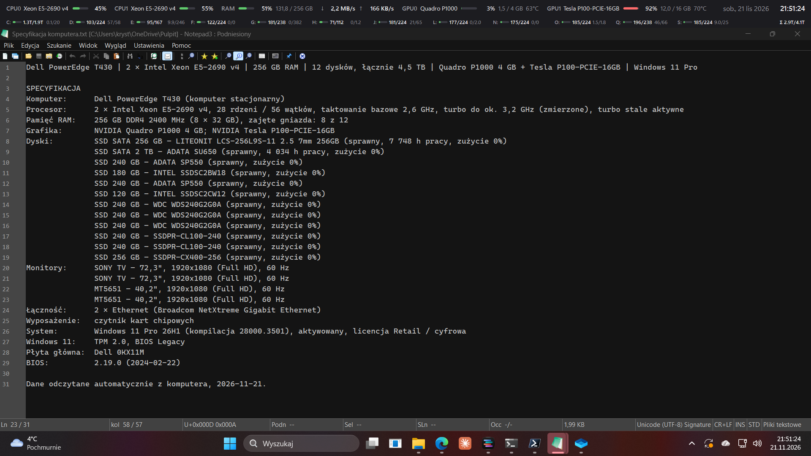

# Specyfikacja komputera

Jedno kliknięcie i masz gotowy opis komputera do ogłoszenia sprzedaży (OLX, Allegro, Vinted…). Program sam odczytuje wszystkie parametry, składa z nich tytuł i specyfikację, kopiuje tekst do schowka, zapisuje go na pulpicie i otwiera w Notatniku. Wystarczy wkleić (Ctrl+V).



*Na zrzucie u góry ekranu paski [SysBar](https://github.com/StarGateCommander/SysBar) i [DiskBar](https://github.com/StarGateCommander/DiskBar).*

## Co odczytuje

| Pozycja | Szczegóły |
| --- | --- |
| Komputer | producent i model (np. `Dell Latitude 5490`, `Lenovo ThinkPad T480`), typ: laptop / stacjonarny / all-in-one / mini PC. Przy składaku: płyta główna |
| Procesor | model, rdzenie / wątki, taktowanie bazowe, **turbo zmierzone** (krótkie obciążenie jednego rdzenia), informacja czy turbo jest stale aktywne |
| Pamięć RAM | pojemność, typ (DDR3/DDR4/DDR5/LPDDR), szybkość, moduły (`2 × 8 GB`), zajęte gniazda |
| Grafika | wszystkie karty, pamięć kart dedykowanych (także NVIDIA Tesla w trybie obliczeniowym, przez `nvidia-smi`) |
| Dyski | rodzaj (SSD NVMe / SSD SATA / HDD / eMMC), pojemność jak u producenta (512 GB, 1 TB), model, stan. Jako administrator: **godziny pracy i zużycie SSD** |
| Ekran | przekątna, rozdzielczość natywna, odświeżanie (laptopy). Przy stacjonarnych: podłączone monitory |
| Bateria | **kondycja w %** względem pojemności fabrycznej, liczba cykli ładowania |
| Łączność | Wi-Fi ze standardem (Wi-Fi 4/5/6/6E/7), Bluetooth, Ethernet |
| Wyposażenie | kamera, kamera IR, czytnik linii papilarnych, napęd optyczny, czytnik kart SD i chipowych, Thunderbolt / USB4 |
| System | wersja Windows, aktywacja, rodzaj licencji (OEM / Retail / zbiorcza), czy klucz jest zapisany w BIOS/UEFI |
| Windows 11 | TPM, UEFI / Legacy, Secure Boot |
| Płyta, BIOS | model płyty, wersja i data BIOS |

Pierwsza linia to gotowy tytuł ogłoszenia, np.:

```
Dell Latitude 5490 | Intel Core i5-8350U | 16 GB RAM | SSD 512 GB | 14" 1920x1080 | Windows 11 Pro
```

### Czego celowo nie zbiera

Numerów seryjnych, klucza produktu Windows, nazwy użytkownika, nazwy komputera w sieci, adresów MAC i IP. Tekst można bezpiecznie wkleić publicznie.

## Użycie

Trzy wersje, każda robi to samo — wybierz jedną:

| Plik | Kiedy |
| --- | --- |
| `SpecyfikacjaKomputera.exe` | najprościej: jeden plik, dwuklik. Skrypt jest wbudowany |
| `Specyfikacja komputera.cmd` | dwuklik; musi leżeć w tym samym folderze co `.ps1` |
| `Specyfikacja-komputera.ps1` | sam skrypt PowerShell, np. do wdrożeń zdalnych |

Na starcie program prosi o uprawnienia administratora (UAC). Dzięki nim odczyta godziny pracy i zużycie dysków oraz wersję TPM. Po odmowie działa dalej, tylko bez tych danych.

Wynik:
- tekst w **schowku**,
- plik `Specyfikacja komputera.txt` na **pulpicie**,
- otwarty **Notatnik** z tym plikiem.

Trwa to około 15 sekund (w tym ~2 s pomiaru turbo procesora).

Uruchomienie samego skryptu:

```
powershell -NoProfile -ExecutionPolicy Bypass -File Specyfikacja-komputera.ps1
```

Plik `.exe` nie jest podpisany cyfrowo, więc SmartScreen może pokazać ostrzeżenie („Więcej informacji” → „Uruchom mimo to”).

## Wymagania

- Windows 10 albo Windows 11.
- PowerShell 5.1 i .NET Framework 4.8 — wbudowane w system, nic nie trzeba instalować.

## Kompilacja

Nie trzeba nic instalować — `build.cmd` używa kompilatora `csc.exe` dostarczanego z .NET Framework:

```
build.cmd
```

Powstaje `SpecyfikacjaKomputera.exe` z wbudowanym skryptem `Specyfikacja-komputera.ps1`. **Po każdej zmianie skryptu trzeba przebudować exe**, bo nosi on własną kopię.

| Plik | Opis |
| --- | --- |
| `Specyfikacja-komputera.ps1` | cała logika: odczyt parametrów i składanie tekstu |
| `Specyfikacja komputera.cmd` | uruchamiacz dwuklikiem dla `.ps1` |
| `Launcher.cs` | uruchamiacz `.exe`: zapisuje wbudowany skrypt do `%TEMP%` i uruchamia go z prośbą o administratora |
| `build.cmd` | kompilacja `SpecyfikacjaKomputera.exe` |
